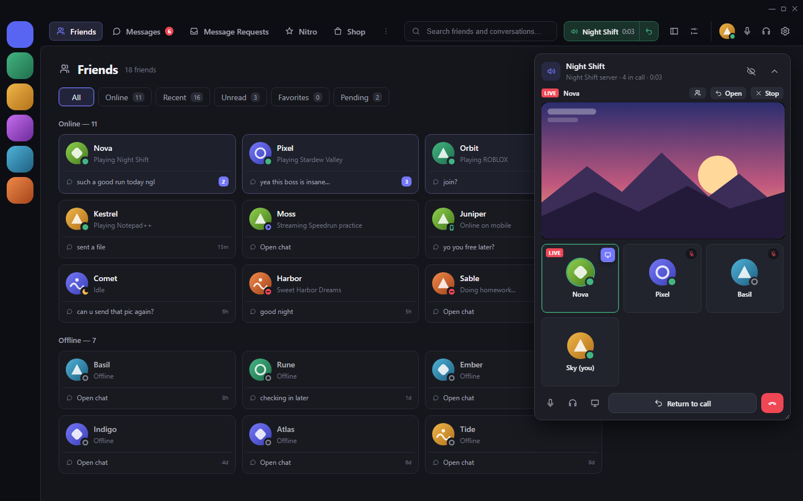
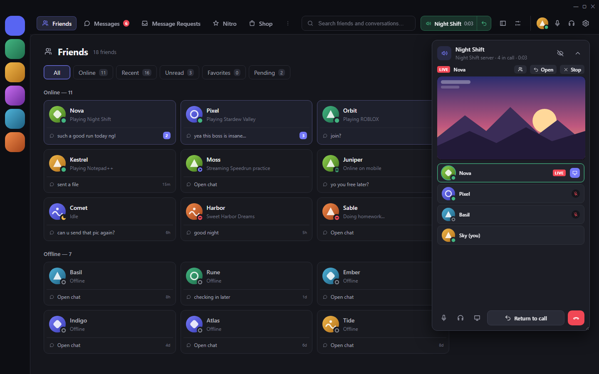
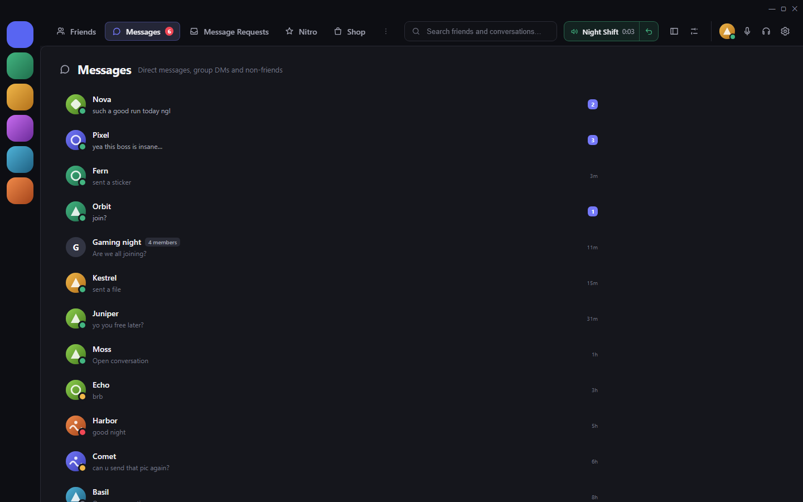
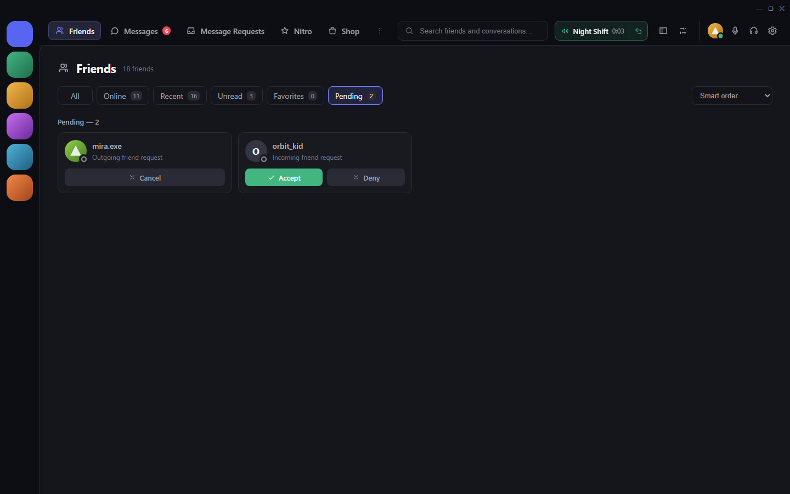
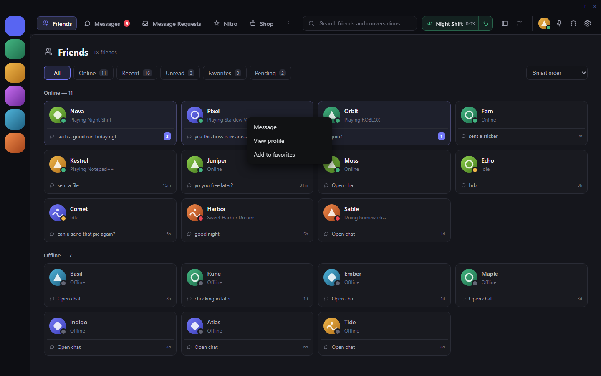

# Discord+ — Refined Dark

[](https://github.com/necromancer124/DiscordPlus-RefinedDark/actions/workflows/build.yml)
[](https://github.com/necromancer124/DiscordPlus-RefinedDark/releases/latest)
[](LICENSE)

**Just Discord, but substantially better.** A Vencord plugin that turns the Discord desktop app into a premium,
native-feeling "vanilla+" Discord, built from the spec in [`MASTER_PROMPT.md`](MASTER_PROMPT.md).

It keeps your real account, friends, servers, messages and voice. It doesn't replace Discord, only refines it.



<table>
  <tr>
    <td></td>
    <td></td>
  </tr>
  <tr>
    <td></td>
    <td></td>
  </tr>
</table>

<sub>Screenshots are the real plugin code running in the development harness (`dev/harness`) with made-up
sample people, abstract avatars and an illustrated stand-in for a screen share. No real users are shown.</sub>

> **Status:** running in the author's own Discord client and refined from real use. Every build is compiled
> against the latest Vencord by the [build check](https://github.com/necromancer124/DiscordPlus-RefinedDark/actions/workflows/build.yml). Discord changes its
> internals often: if something looks wrong, switch that feature off in the plugin settings or disable the plugin.
> Both undo it instantly.

## What you get

| Feature | What it does |
|---|---|
| **Discord+ Home** | Replaces the Friends page. A compact friends grid (≈4 columns) with avatars, presence, games/custom status, latest cached message, unread badges and a ⋮ menu. Click a card for the person's profile, or the chat row under it to open the chat. Filters: All / Online / Recent / Unread / Favorites / Pending (with Accept / Deny / Cancel) / Blocked. Smart, recent, status or A–Z sorting. All friends stay reachable, including offline ones. No Active Now column, no duplicate DM list. |
| **Messages page** | Every conversation in one list: DMs, group DMs and non-friends, newest first, with previews and unread counts. |
| **Top header** | Friends · Messages · Message Requests · Nitro · Shop · Family Centre · Quests, plus search. Narrow windows fold extra tabs into a ⋯ menu. Shown on every page; Discord's content is moved down below it. |
| **Native conversations** | Chats are Discord's own, unchanged, full width under the Discord+ header. The Friends / DM column is gone; Friends and Messages live in the header. |
| **User controls in the header** | Your avatar, mute, deafen and settings sit at the right of the header, so nothing covers the bottom-left. Inside servers Discord's own panel stays. An optional movable floating dock is in the settings (off). |
| **Floating call manager** | Appears when you're in voice but in another server, Home or another DM. Inside the call's own server Discord's native call UI is used. Shows participants, who is speaking (never auto-focuses you), muted/deafened state, the call timer and screen shares: while you watch one, Discord's own live stream window is docked inside the call manager; otherwise the streamer's tile has a watch icon. It can't be resized smaller than its controls. Mute, deafen, share your screen, Return to call, disconnect. Drag it, resize it from the corner, or minimize it to a slim bar. Shrunk small, it shows only the active speaker. |
| **Refined Dark theme** | Matte charcoal surfaces and a restrained violet accent applied to Discord's own colour variables, with a rounder composer and calmer hovers. Accent colour configurable. |
| **Classic view** | One click in the header shows Discord's original Friends page (to accept requests, etc.); one click brings Discord+ back. |

Everything follows `DESIGN.md`: 11px radii, hairline borders, 120–200ms motion, one icon family, reduced-motion support.

## Install (Windows)

**Easiest:** download `DiscordPlus-RefinedDark-<version>.zip` from the [latest release](https://github.com/necromancer124/DiscordPlus-RefinedDark/releases/latest),
extract it, and continue at step 2. Or clone this repository.

1. Install **Git** and **Node.js 18+** if you don't have them:
   ```powershell
   winget install --id Git.Git -e
   ```
   ```powershell
   winget install --id OpenJS.NodeJS.LTS -e
   ```
2. Double-click **`INSTALL.bat`**. It will:
   - download Vencord's source to `%LOCALAPPDATA%\DiscordPlus\Vencord` (or reuse it),
   - copy the Discord+ plugin in and build it,
   - ask before closing Discord, then (the first time) run the **official Vencord installer**. Pick your Discord (usually *Stable*) → *Install*,
   - turn **DiscordPlus** on in Vencord's settings (a backup of that file is kept as `settings.json.discordplus-backup`),
   - find every Discord install (also the per-user copy in `C:\ProgramData\<you>\Discord` that Discord's machine-wide installer makes) and offer to add Discord+ to each,
   - **ask, one by one:** replace Discord on your **taskbar** with Discord+ (same spot, same icon, groups with the Discord window), add Discord+ to the **desktop**, to the **Start menu**, and **check at Windows login**,
   - **start Discord again with Discord+ enabled** (the same Stable / PTB / Canary that was running).
3. That's it. Discord+ is in **Settings → Vencord → Plugins → DiscordPlus** if you want to change anything.

To **update** after changing the plugin, run `INSTALL.bat` again; it re-copies and rebuilds.
If a Discord update removes Vencord, run `INSTALL.bat -Reinject`.
Options: `-Yes` (answer every question with yes), `-UpdateVencord` (pull the latest Vencord first), `-SkipInject` (build only), `-NoStart` (don't start Discord at the end), `-NoLauncher` (no shortcuts / login check), `-VencordDir <path>` (use your own checkout).
If no Discord install has Vencord any more, `INSTALL.bat` injects it again by itself.

### Discord updates

Every Discord update installs a new version folder (`app-1.0.XXXX`) that doesn't contain Vencord, so Discord can
open looking normal again. Vencord itself re-patches updates that happen while it's running. Updates that are
applied while Discord *starts* (often the first start of the day) are covered by the **Discord+ launcher**:

- Open Discord with **Discord+** (the installer can put it on your taskbar in place of Discord). Before
  starting Discord it checks the newest version and patches it if needed, then watches the first few minutes for
  an update and, if one lands unpatched, patches it and restarts Discord once.
- At Windows login a quiet check does the same while Discord's own "open on startup" launches it.
- It patches exactly like Vencord does (Discord's `app.asar` is kept as `_app.asar`) and keeps a copy of
  Vencord's loader, so it still works after Discord deletes old versions. Log: `%LOCALAPPDATA%\DiscordPlus\launcher.log`.

If Discord+ is ever missing anyway, run `INSTALL.bat -Reinject`.

## Undo / revert

| How | Effect |
|---|---|
| Turn a feature off in **Settings → Vencord → Plugins → DiscordPlus** | Just that feature returns to native Discord, instantly. |
| Turn **DiscordPlus** off in the same list | Every Discord+ change is removed live (all of it is classes and styles the plugin owns). Turn it on again any time. |
| `UNINSTALL.bat` → **1. Remove Discord+ only** | Deletes the plugin from the Vencord build and rebuilds. Vencord stays. |
| `UNINSTALL.bat` → **2. Restore original Discord** | Runs the official Vencord uninstaller, so Discord is the unmodified app again, and deletes the Vencord source the installer downloaded. |

The installer records what it did in `%LOCALAPPDATA%\DiscordPlus\install-state.json`, so the uninstaller only
removes what it created (it never deletes a Vencord checkout you made yourself).

## Settings

All in **Settings → Vencord → Plugins → DiscordPlus**, or the sliders icon in the Discord+ header.

| Setting | Default |
|---|---|
| Discord+ home replaces the Friends page | on |
| Header on every page | on |
| Hide native DM list while a conversation is open | off (only works with the floating dock) |
| Floating dock instead of Discord's user panel / snap to edges | off / on |
| Floating call manager | on |
| Hide Discord's bottom-left user/voice panel | on, but only applies while the floating dock **and** call manager are on |
| Refined Dark theme / accent colour | on / `#7478f8` (theme off: Discord+ uses your own theme's colours and accent) |
| Card density · message previews · activities · default filter | comfortable · on · on · All |
| Remove Friends / DM column · user controls in header | on · on |
| Quest promo card → dot on the Quests tab | on |
| Dock Discord's stream window into the call manager | on |
| Quests shortcut chip | off |
| Animations · animation speed | Wave · Normal (also Pop, Slide, Flip, Fade, Off) |
| Check for updates (GitHub releases, shown in the header) | on |
| Reduce motion | off (system setting always respected) |

The Vencord toolbox also has **Discord+ home**, **Check for Discord+ updates** and **Reset Discord+ window positions**.

## Try the look without installing anything

- **`START_PREVIEW.bat`** opens `preview/index.html`, the interactive offline design prototype (sample data, no Discord).
- **`dev/harness`** runs the *real plugin code* in a browser against mock Discord data. See its README.

## Project map

```text
DiscordPlus-RefinedDark/
├── INSTALL.bat / UNINSTALL.bat        ← install, update, revert
├── installer/install.ps1, uninstall.ps1
├── vencord/userplugins/discordPlus/   ← the plugin
│   ├── index.tsx        plugin definition, mounts the app, cleanup on stop
│   ├── settings.ts      all settings + stored positions/favorites
│   ├── discordApi.ts        failure-tolerant wrappers around Discord actions & routes
│   ├── data.ts          read-only views over Discord stores (friends, DMs, unread, previews)
│   ├── layout.ts        finds Discord's layout regions, adds/removes dp-* classes
│   ├── style.css        theme + all component styles (Vencord managed style)
│   └── components/      App, Header, Home, UserDock, CallManager, Icons, common
├── vencord/discord-plus-refined.theme.css   ← colour theme only, as standalone QuickCSS (no plugin)
├── preview/                           ← offline design prototype
├── dev/harness/                       ← real plugin + mocked Discord, for development
├── MASTER_PROMPT.md · DESIGN.md · CHANGELOG.md
├── docs/ARCHITECTURE.md · ROADMAP.md · TESTING.md
├── screenshots/                       ← README screenshots (made-up sample data)
├── .github/workflows/                 ← build check + release automation
└── LICENSE                            ← CC BY-NC 4.0
```

## Releases (for maintainers)

Releases are built by GitHub Actions. Bump the version (`project.json`, `vencord/userplugins/discordPlus/version.ts`,
`installer/install.ps1`), add a `## vX.Y.Z — date` section to `CHANGELOG.md`, then:

```bash
git tag v1.5.1
```
```bash
git push origin v1.5.1
```

The [Release workflow](.github/workflows/release.yml) compiles Discord+ inside the latest Vencord, packages the
install zip and a plugin-only zip, and publishes a GitHub release with that changelog section as the notes.

## License

Discord+ is licensed under **[Creative Commons BY-NC 4.0](LICENSE)**:

- ✅ Free to use, modify and share for **non-commercial** purposes.
- ✅ You must **credit the author, necromancer124, with a link to the original repository**
  (https://github.com/necromancer124/DiscordPlus-RefinedDark) and say what you changed.
- ❌ **No commercial use** without the author's prior written approval. To ask, open an issue.

Vencord is a separate project (GPL-3.0) that you install yourself. Discord+ is distributed as source for you to
build into your own copy.

## Safety and honesty

Discord client mods are **unofficial** and can break Discord's Terms of Service. The account and compatibility risk is yours.

Discord+ uses **no webpack patches**. It only reads Discord's stores and calls the same functions Discord's own
buttons call: open DM, open profile, mute, deafen, disconnect, navigate. It never touches your token, sends
messages, calls Discord's API directly, or exports data. Its only request outside Discord is the optional update
check: GitHub's public releases API, every 6 hours, no account (setting **Check for updates**). Each feature runs inside its own error boundary: if a
Discord update breaks one, that feature renders nothing and the native UI it replaced comes back.
